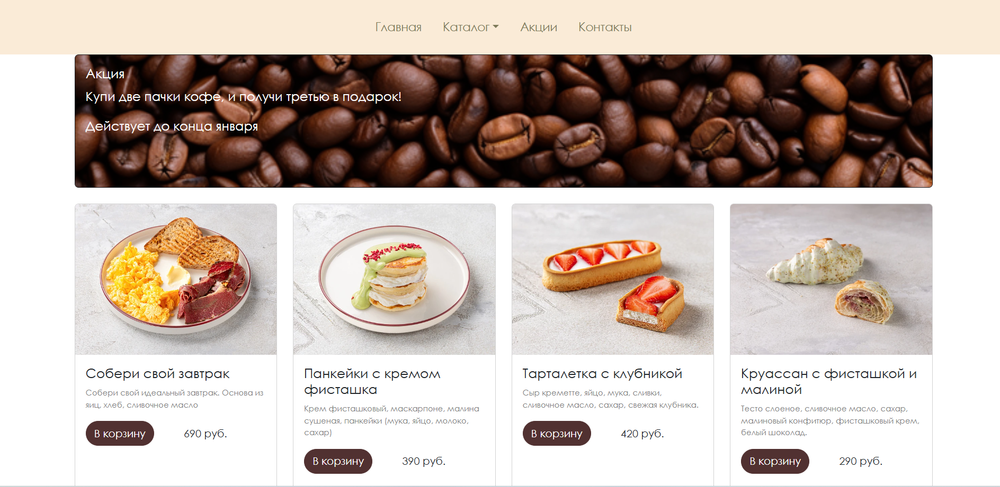

# Bootstrap Coffee Landing

Адаптивный лендинг кофейни на Bootstrap 5. Карточки товаров, баннер с акцией, dropdown-навигация.

## Скриншот

## Стек

- HTML5
- CSS3
- Bootstrap 5.3
- JavaScript (базовый)

## Что реализовано

- Адаптивная сетка Bootstrap
- Навигация с dropdown-меню
- Баннер с наложением текста на изображение
- Карточки товаров
- Футер

## Как запустить

1. Клонирование репозитория:
   git clone https://github.com/anarkulovab/bootstrap_landing_cafe_web
2. Открыть index.html в браузере
